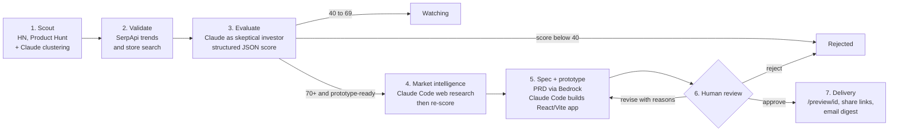

# ForgeAI

Multi-agent product discovery: from market signals to a working, buildable prototype.

**Live app:** https://forgeai.codetrend.com (private login; the sign-in page links to public demo reports and the prototypes the pipeline generated for them).

## Overview

ForgeAI automates the early, repetitive part of product discovery. It reads public market signals, groups them into problem clusters, scores each idea the way a skeptical investor would, researches real competitors on the live web, and, for ideas that clear the bar, writes a product spec and has an AI coding agent build a working React app from it. A person stays in the loop at the points where judgment matters: deciding what is worth building and whether the result is worth keeping.

Ideas enter the system two ways:

- **Scouted:** an operator selects one or more niches (focus profiles such as finance, SMB operations or newsletter creators) and runs the pipeline. Signals are fetched from configured sources and clustered through each niche's lens.
- **Submitted:** a signed-in user describes a problem (who has it, when it hurts, what they imagine). The idea is evaluated, researched and re-scored in the background while the dashboard streams progress over Server-Sent Events.

The output for each idea is a scored report (market fit, competition, monetization, complexity, clarity, real competitors, market timing) and, when approved, a prototype served at `/preview/{id}` that can be shared through revocable links.

## Architecture



Notes on the diagram, so it matches the code exactly:

- In batch runs, market intelligence is applied to a shortlist (up to five ideas with an initial score of 60+ and high clarity); submitted ideas are always researched. The idea is then re-evaluated with the research as added context, and status is decided on the final score.
- A human approval gate sits before prototyping as well: ideas that score 70+ and pass the readiness check land in `pending_approval` and are only built after an operator approves them.
- Step 2 is implemented as a service (`TrendValidator`) but is not yet called by the default run; see [Status](#status).

### Agents and services

| Agent / service | Model or runtime | Responsibility |
| --- | --- | --- |
| `ScoutAgent` | Claude on Amazon Bedrock | Runs source parsers, stores raw signals, and batches unclustered signals to Claude to extract the underlying problem and cluster them by niche (focus profile). Creates opportunities from clusters. |
| `HackerNewsParser`, `ProductHuntParser`, `RedditParser` | HTTP + Product Hunt GraphQL API | Source adapters behind `ISourceParser`. Sources are configured in the `scout_sources` table and matched to a parser by type. |
| `TrendValidator` | SerpApi | Google Trends interest over the last 12 months, Apple App Store and Google Play search and reviews, and Google web search. |
| `EvaluatorAgent` | Claude on Amazon Bedrock | Prompted as a skeptical investor. Returns structured JSON with sub-scores and an overall score. Thresholds come from configuration: below 40 reject, 40 to 69 watch, 70+ prototype. A separate prototype-readiness check keeps vague ideas out of the build step even when they score 70+. |
| `MarketIntelligenceAgent` + `ClaudeCodeMarketResearcher` | Claude Code CLI, headless (`claude -p`) | Runs live web research in an isolated working directory, finds real competitors, and writes a `market-report.json` that is parsed and fed back to the evaluator for a re-score. Bounded by a configurable timeout. |
| `PrototypeAgent` + `PrdGenerator` | Claude on Amazon Bedrock | Generates a product requirements document from the opportunity and its evaluation. |
| `PrototypeAgent` + `ClaudeCodeRunner` | Claude Code CLI, headless | Builds a React + Vite app from the PRD in a versioned directory (`prototype-{id}`, `prototype-{id}-v2`, ...). A build is accepted only when `npm run build` has produced a `dist/` with `index.html` and assets. `node_modules` is removed afterwards. |
| `PipelineOrchestrator` | .NET `BackgroundService` | Scheduled scout, evaluate, prototype loop. Present but intentionally not registered; the pipeline runs on demand. |

## Key design decisions

- **A thin orchestrator coordinates; agents reason.** Control flow, state transitions and persistence live in plain C#. Language models are called for the parts that need judgment: problem extraction, clustering, evaluation, specification, research and code generation.
- **Rules and thresholds live in code and configuration, not in prompts alone.** Score thresholds are read from `Pipeline:EvaluationThresholds`, the status transition is a deterministic `switch` over the model's recommendation plus the readiness flag, and a prototype only counts as built when the build output exists on disk.
- **Structured output at every model boundary.** The evaluator and the market researcher return JSON with a fixed schema, which is parsed into typed models before anything is persisted.
- **Human approval gates.** Nothing is built without an operator approving it, and nothing is considered done until a person accepts the prototype. Every decision and override is written to the pipeline log with its reason.
- **On-demand pipeline.** Runs are triggered from the dashboard for selected niches, or by a single idea submission. This keeps cost and model usage tied to intent rather than a timer. The scheduled orchestrator remains in the codebase and can be re-enabled with one line in `Program.cs`.
- **Feedback loop.** Review decisions are stored in `decision_feedback` with a reason category and notes. When a revision is requested, the next prototype version is generated with that feedback and an excerpt of the previous PRD as context, and the previous prototype is marked superseded.
- **Long-running agent work is isolated.** Claude Code runs as a child process in its own working directory with a timeout, so a slow or failed build cannot block the API. Progress is published as SSE events and pipeline log entries.
- **Controlled sharing.** Prototypes and reports are private by default. `/preview/{id}` is served by middleware that checks ownership (JWT), a share token, or a session cookie issued after a valid token, and refuses paths outside the prototype's `dist/` folder.

## Tech stack

- **Backend:** .NET 9 ASP.NET Core Web API, Dapper, SQL Server (`Microsoft.Data.SqlClient`)
- **AI:** Claude on Amazon Bedrock (`AWSSDK.BedrockRuntime`), Claude Code CLI in headless mode
- **External data:** Product Hunt API, Hacker News, Reddit, SerpApi
- **Email:** Amazon SES (operator digest, email verification, password reset)
- **Auth:** JWT, BCrypt password hashing, single-use emailed tokens, share tokens for public links
- **Frontend:** React 19 + Vite, plain CSS, Server-Sent Events for live stage updates

## Repository structure

```
ForgeAI/
├── ForgeAI.sln
├── ForgeAI.Api/              # ASP.NET Core host: controllers, JWT + preview middleware, SSE, DI wiring
│   ├── Controllers/
│   ├── Middleware/
│   └── appsettings.example.json
├── ForgeAI.Core/             # Domain models, DTOs and repository/service interfaces
├── ForgeAI.Data/             # Dapper repositories and SQL connection factory
├── ForgeAI.Services/         # Agents, parsers, validation, market intelligence, prototype build, auth, email, sharing
│   ├── Agents/
│   ├── MarketIntelligence/
│   ├── Orchestrator/
│   ├── Parsers/
│   ├── Prototype/
│   └── Validation/
├── dashboard/                # React 19 + Vite operator and user dashboard
└── database/                 # SQL scripts: auth/sharing tables and niche (focus profile) seed data
```

## Getting started

### Prerequisites

- .NET 9 SDK
- SQL Server (Express or Developer edition is fine)
- Node.js 20+ and npm
- AWS credentials with access to Claude models on Amazon Bedrock (and SES if you want email)
- Claude Code CLI installed and authenticated, available on `PATH` as `claude`
- Optional: a Product Hunt API token and a SerpApi key

### Configuration

```bash
cp ForgeAI.Api/appsettings.example.json ForgeAI.Api/appsettings.json
```

Then fill in:

- `ConnectionStrings:ForgeAI`
- `Jwt:Secret` (a long random string)
- `AWS:Region` and `AWS:Bedrock:ModelId`. The Bedrock client uses the standard AWS credential chain (environment variables, shared profile or instance role). The SES client reads `AWS:AccessKeyId` / `AWS:SecretAccessKey`, or `AWS:SES:*` if set.
- `AWS:SES:FromEmail` (a verified SES identity) and `AWS:SES:ToEmail` (operator digest recipient)
- `ProductHunt:Token` and `SerpApi:ApiKey`
- `Pipeline:PrototypesBasePath` and `Pipeline:ResearchBasePath`: working folders for Claude Code. Relative paths resolve against the API's working directory.

`appsettings.json` and environment-specific variants are ignored by git; only the example file is tracked.

### Database

Create a database named `ForgeAI`, then run the scripts in `database/`:

1. `local-migrations.sql`: users, email verification, sessions, password-reset tokens, share tokens (idempotent)
2. `seed-niches.sql`, then `phase2-niches-update.sql`: focus profiles used to cluster signals by niche

`phase1-auth-tables.sql` is the original, non-idempotent version of the auth tables and is superseded by `local-migrations.sql`.

The core pipeline tables (`scout_sources`, `raw_signals`, `opportunity_clusters`, `opportunities`, `evaluations`, `prototypes`, `reviews`, `decision_feedback`, `agent_runs`, `pipeline_logs`, `notifications`, `focus_profiles`) are not scripted in this repository. Their shape is defined by the models in `ForgeAI.Core/Models` and the queries in `ForgeAI.Data/Repositories` (snake_case columns mapped by Dapper). Scout sources can be seeded through `POST /api/scout/sources/seed`.

### Run

```bash
# API (listens on http://localhost:5050)
cd ForgeAI.Api
dotnet run

# Dashboard (http://localhost:5173, calls the API on :5050)
cd dashboard
npm install
npm run dev
```

Health check: `GET http://localhost:5050/api/health`.

To serve the built dashboard from the API instead, run `npm run build` in `dashboard/` and point `Pipeline:DashboardPath` at `dashboard/dist`.

## Status

ForgeAI is a working system deployed for private use, built as a single-operator tool with multi-user accounts and sharing added on top.

- The pipeline runs on demand from the dashboard; the scheduled `PipelineOrchestrator` is disabled.
- `TrendValidator` (SerpApi) and `RedditParser` are implemented but not wired into the default run: the validator is registered but not yet called by an agent, and the Reddit parser is not registered in DI.
- The review-decision endpoint (`POST /api/reviews/{id}/decide`) and versioned regeneration from `decision_feedback` are implemented in the API. The current dashboard drives approval, rejection and re-queueing through the simpler opportunity promote and dismiss endpoints.
- Not implemented: business plan generation, billing, and the user-facing "Request Revision" action on reports (shown as disabled).
- There is no automated test suite.

> **About this repository.** This is a public snapshot of a project I develop privately. It was published with credentials, account identifiers and private data removed, so its history starts at publication.

---

Built by Efraim Hernandez · https://efraprojects.com
